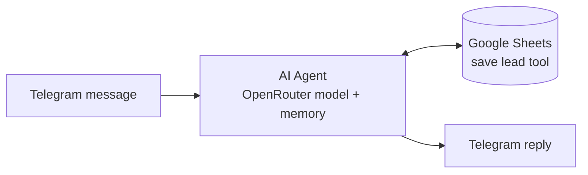

# Real Estate Lead Qualification Agent

A Telegram chatbot built with **n8n** that qualifies real estate leads. It asks a few questions one at a time, scores the lead out of 100 behind the scenes, saves the details to Google Sheets and routes the lead to the next step.

## What it does

1. Greets the visitor and explains it will ask a few quick questions.
2. Asks **only for missing information**, one question at a time. If the visitor already said "I want to buy a new apartment", it does not ask again.
3. Shows a summary and asks the visitor to confirm.
4. Scores the lead internally (the visitor never sees the score).
5. Saves the answers and the score to Google Sheets after confirmation.
6. Routes the lead: high scores are invited to book an appointment, lower scores are told an agent will contact them.

Information collected: property type, buy or rent, new or resale, first purchase, timeline, budget, name, email and phone.

## Architecture



- **Memory:** the last 15 messages, kept separately for each Telegram user.
- **Tool:** a Google Sheets "append row" tool that the agent calls after the visitor confirms.

## Scoring model

| Question | Points |
|---|---|
| Property type | Apartment 10, Villa 15, Commercial 10 |
| Buy or rent | Buy 15, Rent 5 |
| New or resale | New 10, Resale 10 |
| First purchase | Yes 5, No 10 |
| Timeline | Immediately 20, within 1 month 15, 1-3 months 10, 3-6 months 5, 6+ months 0 |
| Budget | Above $1M 20, $700k-$1M 15, $400k-$700k 10, $200k-$400k 5, below $200k 0 |

The scoring rules live in the agent's system prompt (`workflows/lead-qualification-agent.json`).

## Tech stack

| Part | Tool |
|---|---|
| Automation | n8n |
| Chat channel | Telegram Bot API |
| Language model | OpenRouter (free model, easy to swap) |
| Lead storage | Google Sheets |

## Setup

1. **Telegram bot.** Talk to [@BotFather](https://t.me/BotFather), create a bot and keep the token.
2. **OpenRouter.** Create an API key at [openrouter.ai](https://openrouter.ai).
3. **Google Sheet.** Create a sheet with these columns in row 1: `Property type`, `Buy / Rent`, `New / Resale`, `First Purchase`, `Timeline`, `Budget`, `Name`, `Email`, `Phone`, `Score`.
4. **Import the workflow.** In n8n choose Workflows, then Import from file, and pick `workflows/lead-qualification-agent.json`.
5. **Create credentials in n8n:** Telegram, OpenRouter and Google Sheets (OAuth2). Credentials stay inside n8n and are not part of the exported file.
6. **Replace the placeholder** `YOUR_GOOGLE_SHEET_ID` in the Google Sheets tool node. It is the part of the sheet URL between `/d/` and `/edit`.
7. Activate the workflow and message your bot.

## Example conversation

> **Visitor:** Hi, I want to buy an apartment
> **Bot:** Hi! Happy to help you find the right property. Is this a new apartment or a resale?
> **Visitor:** New
> **Bot:** Great. Is this your first property purchase?
>
> *...timeline, budget and contact details follow...*
>
> **Bot:** Here is what I have: Apartment, Buy, New, ... Is everything correct?

## Limitations and next steps

- The score is calculated by the language model. Moving the arithmetic into an n8n Code node would make it exact and repeatable.
- The prompt saves a lead when the score is "> 80" but routes at ">= 80". One consistent threshold would remove the gap at exactly 80.
- Only high-scoring leads are saved. Saving every lead with a High / Medium / Low label would keep the full pipeline.
- The tool node is named differently from the `sheet_save_lead` tool mentioned in the prompt. Matching the names would make tool calls more reliable.
- Appointment booking is not connected yet (calendar integration is a natural next step).

## Repository structure

```
workflows/
  lead-qualification-agent.json
```

## Author

Ahmed Abdelazeem Mohamed ([GitHub](https://github.com/Ahmed-Abdelazeem-466))

## License

MIT. See [LICENSE](LICENSE).

---

*README drafted with AI assistance (Claude) and reviewed by the author.*
